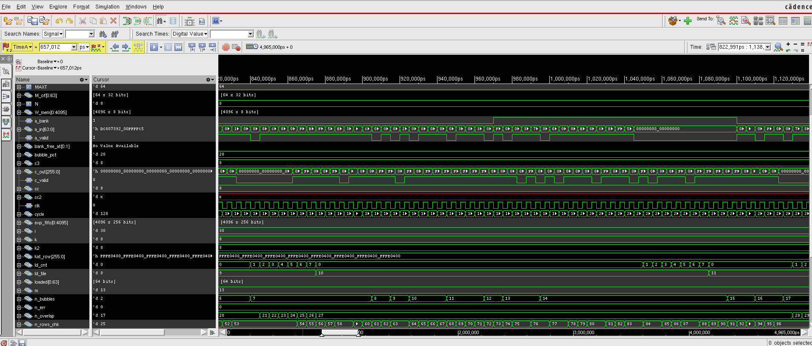
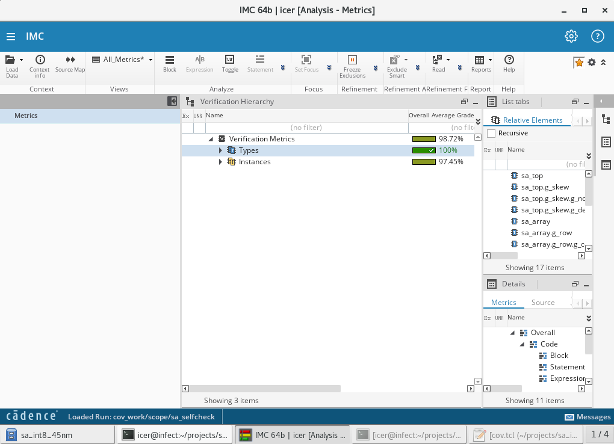
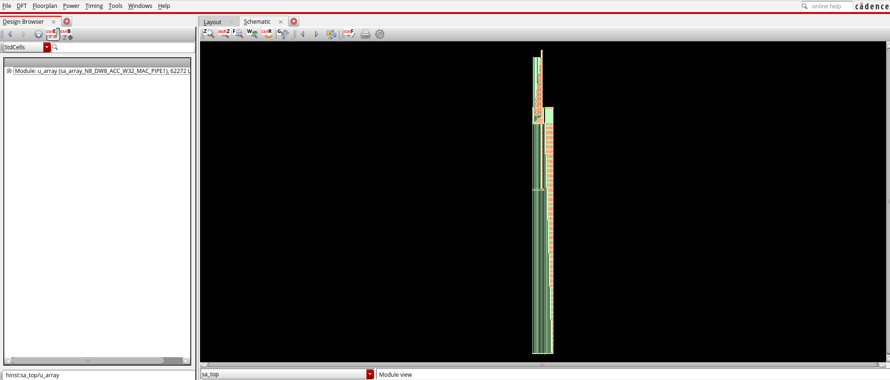
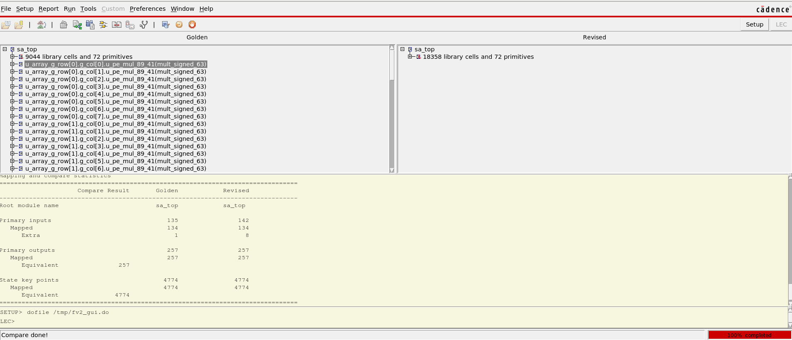
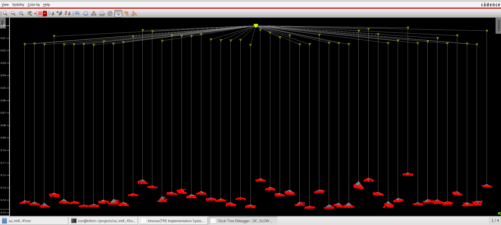
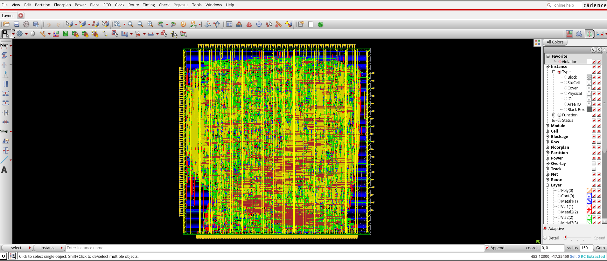
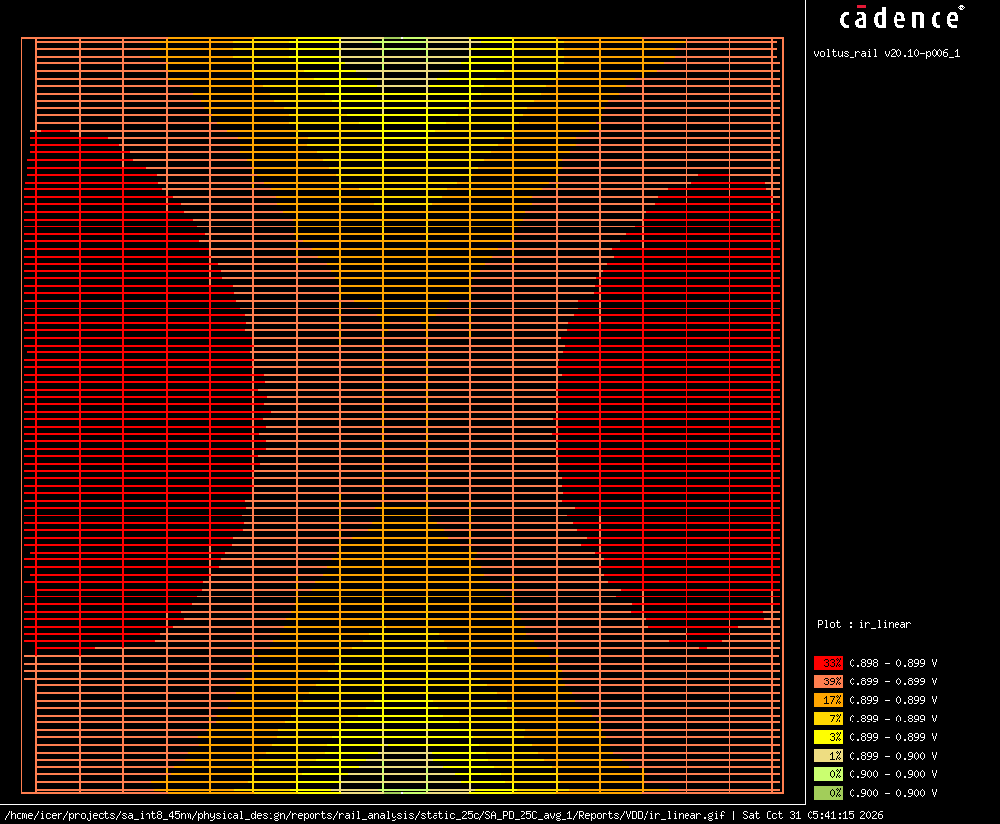
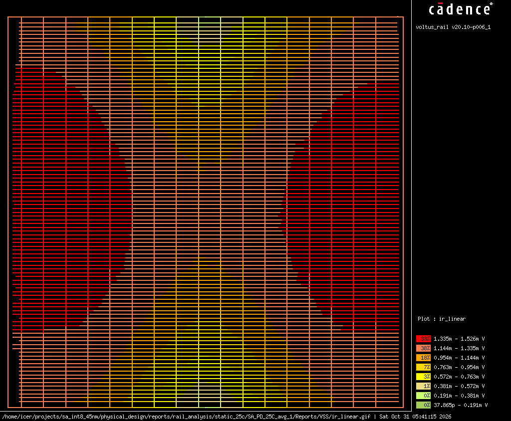
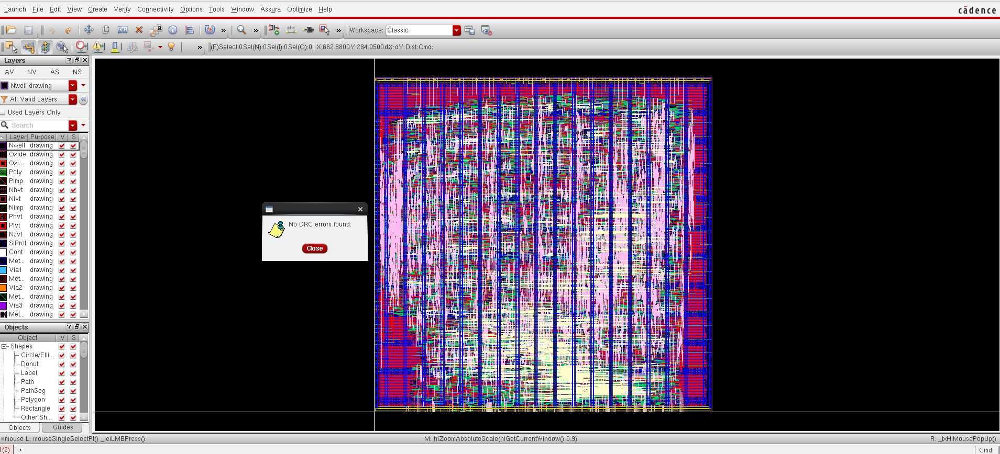
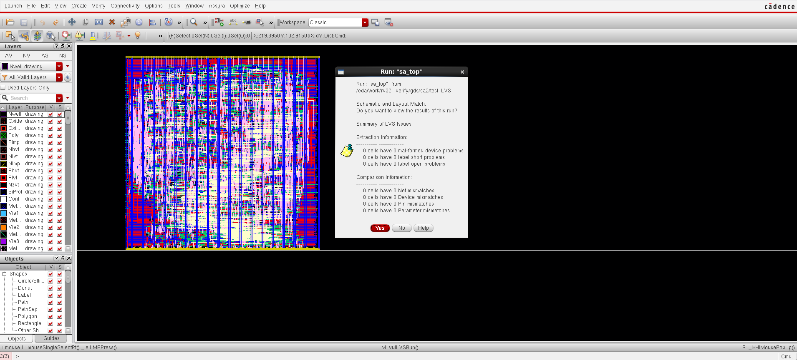

# 8×8 INT8 Weight-Stationary Systolic Array — RTL-to-GDSII in 45 nm

[](https://www.cadence.com/)
[](NOTICE.md)
[](#physical-design-and-signoff)
[](#physical-design-and-signoff)
[](LICENSE)

A matrix-multiply accelerator core — `C = A × W`, int8 × int8 → int32, **64 MACs per
cycle** — with Gemmini-style double-buffered weights, taken through a complete
**Cadence RTL-to-GDSII flow** (simulation → synthesis → DFT → ATPG → equivalence check →
place & route → IR drop → DRC/LVS) on the **gpdk045 / gsclib045 45 nm** library.

The block is hardened as a **core-only macro** (signal pins on the core boundary, no I/O
pad ring), the way a compute tile is built before top-level chip integration.
Flow scripts are derived from [ALU_32b](https://github.com/Zhungg/ALU_32b).

> **Scope note.** The Cadence tools and the GPDK045 PDK are licensed products and are
> **not** distributed here. See [NOTICE.md](NOTICE.md).

## Contents

- [Results at a glance](#results-at-a-glance)
- [Design](#design)
- [Flow walkthrough](#flow-walkthrough)
- [Issues found and fixed](#issues-found-and-fixed)
- [Repository layout](#repository-layout)
- [Getting started](#getting-started)
- [Limitations](#limitations) · [License](#license)

---

## Results at a glance

| Item | Result |
| :--- | :--- |
| Target clock | 200 MHz (5 ns) functional · 20 MHz (50 ns) scan shift |
| Functional verification (RTL) | 551 output rows × 8 results checked (directed + random tiles, 111 bubbles, 128 load/compute-overlap cycles, async reset), 0 errors, **TEST PASSED** |
| Code coverage (Xcelium/IMC, DUT `sa_top`, run with `MAC_PIPE = 0`) | **98.72 %** overall grade (types 100 %, instances 97.45 %) |
| Synthesis + DFT (Genus, slow 0.9 V / 125 °C) | 18 358 cells, 72 263 µm² cell area, 4 774 flops; WNS **+875 ps** |
| DFT | Muxed scan, **8 chains × 597 bits**, `OAI32X1` dont_use (0 instances) |
| ATPG (Modus, stuck-at) | **99.84 %** test coverage (**99.99 %** adjusted), 166 348 faults, 34 test sequences |
| Equivalence (Conformal LEC, 2 stages) | RTL ≡ `fv_map` (5 031 points + 1 122 merged flops) · `fv_map` ≡ DFT netlist (257 POs + 4 774 DFFs): **PASS** |
| Gate-level sim (post-synthesis) | Zero-delay **PASS** · Genus SDF **PASS** (100 % path delays annotated) |
| Floorplan / placement | Core 348.8 × 345.4 µm, 408 signal pins, 18 430 cells (incl. 72 port buffers), utilization 61.8 % |
| Post-route setup (OCV + SI + CPPR, slow 0.9 V / 125 °C) | **+0.564 ns** functional · +43.7 ns scan · 0 violating paths |
| Post-route hold (fast 1.1 V / 0 °C) | **+0.018 ns** functional · +0.016 ns scan · 0 violating paths |
| DRV | max transition / capacitance / fanout: 0 / 0 / 0 |
| Clock tree | 4 774 sinks, 48 clock buffers, skew 28 ps (functional, slow) |
| DRC | Innovus: **0** on the final layout · Assura: **0** (run before the 72-buffer ECO) |
| Process antenna (Innovus `check_process_antenna`) | **0 violations** |
| LVS (Assura, PG netlist vs. layout) | **Match** — 0 net / device / pin / parameter mismatches |
| Power (post-route, `FUNC_SETUP_VIEW`, vectorless) | **6.94 mW** @ 0.9 V (internal 77 %, switching 23 %) |
| Static IR drop (Voltus, 25 °C) | VDD drop ≈ **2 mV**, VSS bounce **1.53 mV** (limit 45 mV), 0 violations |

Evidence for every number is kept in the repo:

| Stage | Evidence |
| :--- | :--- |
| RTL / gate-level simulation | [`simulation/reports/`](simulation/reports/) |
| Synthesis / DFT | [`synthesis/dft_run/reports/`](synthesis/dft_run/reports/) |
| ATPG | [`synthesis/atpg/`](synthesis/atpg/) |
| Equivalence check | [`equivalence_checking/reports/`](equivalence_checking/reports/) |
| Place & route, power, clock tree, checks | [`physical_design/signoff/`](physical_design/signoff/README.md) |
| IR drop | [`physical_design/signoff/rail_analysis/`](physical_design/signoff/rail_analysis/) |
| Screenshots | [`img/`](img/) |

Databases, raw Innovus/Voltus reports, SDF/SPEF and the GDS are git-ignored
(the GDS embeds gsclib045 cell layouts); regenerate them with the scripts below.

---

## Design

Full specification: [docs/SPEC.md](docs/SPEC.md).

```
           w_in[0..7]  (weight preload: shifts DOWN the columns, 8 cycles)
              |    |         |
a_in[0] -[reg]-> PE00 -> PE01 -> ... -> PE07      a  (int8)  moves RIGHT
a_in[1] -[reg]-[1 skew]-> PE10 -> ...  -> PE17    ps (int32) moves DOWN
  ...                                             W[r][c] stays in PE(r,c)
a_in[7] -[reg]-[7 skew]-> PE70 -> ...  -> PE77
                           |               |
                    [deskew: column c delayed 7-c] -> c_out[0..7], c_valid
```

- **Dataflow:** weight-stationary; one row of A enters and one row of C leaves per cycle.
- **PE:** `ps_out = ps_in + a_in × W[a_bank]`; two weight registers per PE (Gemmini
  `c1/c2`) so the next tile loads while the current one computes; the bank bit travels
  with the activation (Gemmini `propagate`).
- **`MAC_PIPE = 1`** (used for the implementation): a product register splits multiply
  and accumulate into two cycles (+16 flops per PE, latency 2N + 1 = 17 cycles).
- **Throughput:** 64 MAC/cycle = 12.8 GMAC/s at 200 MHz.
- **Reset:** asynchronous, active low.

### Ports of `sa_top`

| Port | Dir | Width | Description |
| :--- | :---: | :---: | :--- |
| `clk`, `rst_n` | in | 1 | Clock, async active-low reset |
| `a_in` | in | 64 | Row of A, `a_in[k*8 +: 8] = A[m][k]` |
| `a_valid`, `a_bank` | in | 1 | Row valid · weight bank used by this row |
| `w_in` | in | 64 | Row of W, `w_in[c*8 +: 8] = W[r][c]` |
| `w_load`, `w_bank` | in | 1 | Shift weights down one row · bank being loaded |
| `c_out` | out | 256 | Row of C, `c_out[c*32 +: 32] = C[m][c]` |
| `c_valid` | out | 1 | `c_out` valid |
| `SE`, `scan_in_0..7`, `scan_out_0..7` | — | — | Added by Genus DFT |

---

## Flow walkthrough

```
  RTL sim + coverage ──> Genus synth + DFT ──> GLS ──> Modus ATPG ──> Conformal LEC
     (Xcelium/IMC)                                                        │
  Assura DRC/LVS <── Voltus IR <── Innovus 01..07 <──────────────────────┘
```

### 1. Functional verification and coverage
`tb/tb_sa_top.v` is self-checking: a reference matrix product, an expected-row FIFO
(order and count), directed tiles (identity, −128 × −128, 127 × −128, alternating), random
tiles of random height with 20 % bubbles, a load/compute-overlap counter and an async reset
during streaming. The same testbench runs at gate level (`+define+GLS`, `+define+SDF`).

| SimVision waveform | IMC coverage |
| :---: | :---: |
|  |  |

### 2. Synthesis and DFT
Genus maps to gsclib045 (slow corner) and inserts 8 muxed-scan chains. With a
single-cycle MAC the worst path (input skew register → bank mux → 8×8 multiplier → 32-bit
adder) left only **+5 ps**; enabling `MAC_PIPE` moved the critical path to the multiplier
half and raised WNS to **+875 ps**. The pre-change report is the reason for the switch
(see [CHANGELOG.md](CHANGELOG.md)).



### 3. ATPG and equivalence
Modus reaches 99.84 % stuck-at coverage with 34 patterns — the 64 identical PEs are tested
in parallel. The 271 redundant faults sit on the sign-extension logic that Genus merged.
LEC is done in **two stages** because of that merge (see [Issues](#issues-found-and-fixed)).



### 4. Place and route (Innovus, batch `run_pnr.sh 01..07`)
Pins follow the dataflow: activations on the left (Metal3), weights on top (Metal4),
results at the bottom (Metal4, 257 pins), clock/reset/scan on the right. Power: Metal10/11
ring (2 µm), Metal10 stripes every 20 µm, Metal1 follow-pins. Hold fixing runs after CTS
and after route; post-route optimisation is OCV + SI-aware with CPPR.

| Clock tree (Innovus CCOpt) | Layout |
| :---: | :---: |
|  |  |

### 5. Power-rail analysis (Voltus, static)

| VDD IR drop | VSS ground bounce |
| :---: | :---: |
|  |  |

### Physical design and signoff
- Innovus DRC 0, `verify_connectivity` clean, PG connectivity clean, process
  antenna 0 violations, `OAI32X1` = 0.
- Assura DRC: 0 violations (run before the 72-buffer ECO). Assura LVS on the final layout: **match**.

| DRC — no errors (Assura) | LVS — schematic and layout match (Assura) |
| :---: | :---: |
|  |  |

#### LVS fix: one net per output port
The first LVS run matched every net and device but reported 64 shorts / 16 unmatched pins.
The upper bits of each 32-bit `c_out` are sign extensions; Genus merges their flops and
ties several output ports together with `assign` statements, so one metal net carried
several pin labels. `physical_design/scripts/remove_assigns.awk` replaces the 72 assigns
with `BUFX2` instances (marked `dont_touch` in `01_init.tcl`), giving every port its own
net. The Genus netlist itself is unchanged, so LEC, GLS and ATPG still apply.

---

## Issues found and fixed

| Symptom | Root cause | Fix |
| :--- | :--- | :--- |
| Genus `VLOGPT-9` on `sa_top.v:152` | `localparam` in a generate block is SystemVerilog | `read_hdl -sv`; LEC golden read as `-systemverilog` |
| Genus WNS +5 ps | multiply + 32-bit accumulate in one cycle | `MAC_PIPE = 1` |
| LEC: 846 non-equivalent flops, 1 122 unmapped | Genus sequential merge of sign-extension flops (GLO-42) | Two-stage LEC: RTL → `fv_map` (Genus dofile, `lec -xl`), `fv_map` → DFT netlist |
| Innovus 06 `IMPOPT-6080` | SI-aware post-route opt needs OCV analysis | `timing_analysis_type ocv`, `timing_analysis_cppr both` |
| 18 DRC: Metal10 parallel-run-length spacing | VDD/VSS stripe pair 0.5 µm apart, LEF needs 1.25 µm | stripe spacing 1.5 µm |
| LVS: 64 shorts, 16 unmatched pins | sign-extended `c_out` bits share one net via `assign` | `remove_assigns.awk`: 72 `BUFX2` port buffers, `dont_touch` (Innovus `setDoAssign` via `eval_legacy` had no effect in Stylus) |
| Assura `AVLVSNN-10100` duplicate cell `CLKBUFX12` | `saveNetlist -phys` writes empty leaf-cell modules | keep only `module sa_top` for LVS (or `saveNetlist -excludeLeafCell`) |
| 406 `IMPVFC-94` dangling wires after power plan | open ends of the Metal1 rails at the core edge | none needed — final PG check clean, Voltus 0 floating instances |

---

## Repository layout

```text
.
├── rtl/                     sa_pe.v, sa_array.v, sa_top.v
├── tb/                      tb_sa_top.v (self-checking, RTL + gate level)
├── constraints/             SDC: functional 200 MHz, functional DFT add-on, scan 20 MHz
├── simulation/              run_rtl.sh (+coverage), run_gls.sh, reports/
├── synthesis/               Genus DFT script, netlist/SDC/SDF/SCANDEF, reports, Modus scripts + ATPG logs
├── equivalence_checking/    Two-stage LEC dofiles and reports
├── physical_design/         run_pnr.sh, scripts/01_init … 08_rail, layer maps, post-route netlists, signoff/
├── docs/                    Design specification (SPEC.md)
├── img/                     Figures used in this README
├── flow_config.sh           Single source of truth for tool and PDK paths
├── Makefile                 Open-source lint + simulation (no Cadence needed)
└── NOTICE.md                Third-party / PDK licensing notice
```

---

## Getting started

### A. Quick check without Cadence
Requires [Icarus Verilog](https://steveicarus.github.io/iverilog/) (and optionally
[Verilator](https://www.veripool.org/verilator/)):

```bash
make sim            # self-checking testbench
make lint           # Verilator lint
make sim NTILES=50 SEED=7
```

### B. Full Cadence flow

```bash
source flow_config.sh                                   # tool / PDK paths
cd simulation && ./run_rtl.sh && cd ..                  # RTL sim + coverage
cd synthesis && ./run_synth_dft.sh && ./run_atpg.sh && cd ..
cd simulation && ./run_gls.sh syn && ./run_gls.sh syn sdf && cd ..
awk -f physical_design/scripts/remove_assigns.awk     synthesis/dft_run/outputs/sa_top_syn_dft.v > synthesis/dft_run/outputs/sa_top_syn_dft_noassign.v
# LEC stage 1 (inside synthesis/dft_run):  lec -64 -xl -nogui -dofile fv/sa_top/rtl_to_fv_map.do
# LEC stage 2:                             equivalence_checking/sa_fvmap_dft_lec.do
cd physical_design && for s in 01 02 03 04 05 06 07 08; do ./run_pnr.sh $s || break; done
```

`run_pnr.sh` checks each stage's `STAGE_xx_DONE` marker in `logs/<stage>.log`; move old
logs away before re-running a stage (Innovus writes `*.log1` when the log already exists).

---

## Limitations

- Compute array only: no on-chip SRAM, controller or DMA; data enters through 408 pins.
- Core-only macro: no I/O pads and no top-level PG pins / LEF abstract yet.
- Vectorless power and **static** IR only (no VCD-based power, dynamic IR or EM).
- Single RC technology file; one SVT library; no clock gating; stuck-at ATPG only.
- 200 MHz is conservative for 45 nm (post-route setup slack 0.63 ns).

## License

Source code, scripts and documentation are released under the
[Apache License 2.0](LICENSE). Cadence tools, the GPDK045 PDK and gsclib045 are
**not** covered by this license and are not included; see [NOTICE.md](NOTICE.md).
